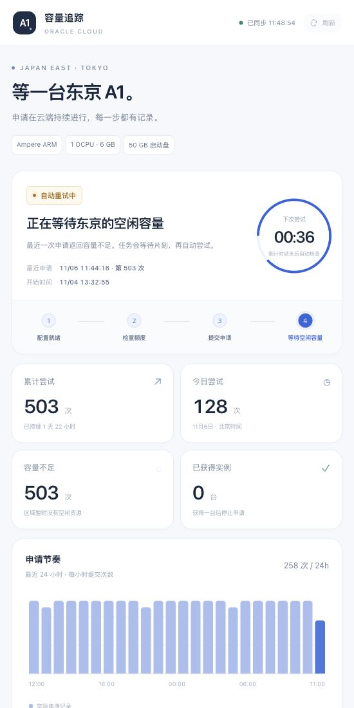

# Oracle A1 Capacity Dashboard

[](https://github.com/lihaoranlzy/oracle-a1-capacity-dashboard/actions/workflows/tests.yml)
[](LICENSE)

**Oracle A1 自动申请脚本 + 私人实时状态页。**

A conservative OCI A1 capacity retry runner with persistent request tokens, systemd deployment, and a read-only dashboard. The dashboard uses only the Python standard library. Defaults: **1 OCPU / 6 GB RAM / 50 GB boot disk**, one new instance per task, approximately five minutes between capacity retries.

用已有 Linux 虚机持续申请 A1，把累计次数、下一次尝试、实际返回结果和历史记录展示在网页里。适合不想一直手动刷新控制台的人。**不保证拿到容量，也不保证账户账单为零。**



*截图来自早期运行记录，展示的是“容量不足”，不是成功率承诺。公开仓库不包含账号、密钥、真实配置或运行数据库。*

## 功能

- 通过 Oracle 官方 OCI CLI 发起 API 请求，无需浏览器自动点击。
- 从账户配置读取主区域；可复用原实例的子网、网络安全组与 SSH 公钥，也可直接指定已有子网和公钥。
- 自动选择适配 A1 的 Oracle Linux 9 官方镜像；在子网支持的可用域之间轮换，故障域自动选择。
- 缺货时等待 300–330 秒；限流、网络超时和临时服务错误采用更长的退避时间。
- 创建前落盘请求与幂等令牌，超时后核查并复用原请求；进程锁避免同一配置同时运行。
- 权限、配额和参数错误会停止；发现同名但不属于当前任务的实例也停止。
- 可选 systemd 后台运行，限制 CPU、内存及交换空间。
- 网页每 5 秒刷新，支持北京时间今日统计、倒计时、24 小时节奏、逐次记录、筛选和 CSV 导出。
- SQLite 持久化展示历史，重复读取日志不会重复计数。

## 环境

- 申请脚本：Linux 或 macOS，Python **3.9+**，已配置 API 登录的 OCI CLI。
- 后台服务与真实日志看板：带 **systemd** 的 Linux（如 Oracle Linux 9、Ubuntu），需要 sudo。
- 看板静态资源和后端无 npm、Node.js 或额外 Python 依赖。
- 需要已存在、允许公网 IP 的子网，以及 SSH 公钥；网络路由和安全规则由你自行配置。
- 当前只面向 OCI 商业区域。界面和日志使用中文，统计按北京时间 UTC+8。

## 1. 下载与安装 CLI

```bash
git clone https://github.com/lihaoranlzy/oracle-a1-capacity-dashboard.git
cd oracle-a1-capacity-dashboard
python3 -m venv .venv
source .venv/bin/activate
python -m pip install -r requirements.txt
oci --version
```

如果系统缺少 venv 或 pip，先按发行版说明安装对应的 Python 组件。小内存机器建议使用独立 Python 环境。[OCI 官方安装说明](https://docs.oracle.com/en-us/iaas/Content/API/SDKDocs/climanualinst.htm)。

## 2. 配置 Oracle API 登录

```bash
oci setup config
oci iam region-subscription list
```

按引导填写用户 OCID、租户 OCID、主区域和 API 私钥路径，然后将对应的 **API 公钥**添加到 Oracle 控制台的“用户设置 → API 密钥”。API 密钥与 SSH 登录密钥不同。

私钥留在本机，默认配置在 `~/.oci/config`。不要将私钥、账户配置、生成的申请配置、日志或数据库提交到 GitHub。[Oracle 官方密钥配置说明](https://docs.oracle.com/en-us/iaas/Content/API/Concepts/apisigningkey.htm)。

## 3. 初始化与只读检查

运行数据建议放在代码仓库外的独立目录：

```bash
export A1_RUNTIME_DIR="$HOME/.local/state/oracle-a1"
python oracle_a1_retry.py --config "$A1_RUNTIME_DIR/a1-config.json" --init
python oracle_a1_retry.py --config "$A1_RUNTIME_DIR/a1-config.json" --check
```

`--init` 会提示选择原实例，读取它的网络与 SSH 公钥。`--init` 和 `--check` 均不创建云资源。

**没有已有虚机时**，指定已创建的公网子网和自己的 SSH 公钥：

```bash
python oracle_a1_retry.py \
  --config "$A1_RUNTIME_DIR/a1-config.json" \
  --init \
  --subnet-id YOUR_SUBNET_OCID \
  --ssh-public-key "$HOME/.ssh/id_ed25519.pub"
```

已有子网需要能通过 Internet Gateway 出网；直接指定子网的模式不自动添加网络安全组，沿用子网的安全列表。若需要 NSG，可在首次运行前修改生成配置中的 `nsg_ids`。

非默认 OCI profile 可在初始化时加 `--profile PROFILE_NAME`；也支持 `OCI_CLI_PROFILE`。生成配置后，所有任务继续使用相同 profile。

## 4. 选择一种运行方式

### A. 前台运行

```bash
python -u oracle_a1_retry.py --config "$A1_RUNTIME_DIR/a1-config.json"
```

按 Ctrl+C 停止，在原目录使用相同配置再次运行可继续。不要删除状态文件或在其他电脑并行运行其副本。前台模式适合检查脚本；systemd 日志看板需要下面的后台方式。

### B. Linux 后台运行与看板

先退出前台任务。确保本节变量与第 3 步一致，虚拟环境仍已激活，然后安装服务：

```bash
sudo python3 deploy/install_services.py \
  --user "$(id -un)" \
  --config "$A1_RUNTIME_DIR/a1-config.json" \
  --oci-bin "$PWD/.venv/bin/oci"
```

安装器根据当前用户名和目录生成服务，复制选定程序到 `/opt/oracle-a1-capacity-dashboard`，不复制密钥或运行配置。**安装器不会启动任务或创建云资源。**确认第 3 步检查结果后，显式启动：

```bash
sudo systemctl enable --now oracle-a1-retry oracle-a1-dashboard
sudo journalctl -u oracle-a1-retry -n 20 --no-pager
```

网页只监听虚机的 `127.0.0.1:28181`。在自己的电脑上建立 SSH 隧道：

```bash
ssh -N -T -L 127.0.0.1:28081:127.0.0.1:28181 YOUR_SSH_HOST
```

然后打开 **http://127.0.0.1:28081/**。`YOUR_SSH_HOST` 替换成自己的 SSH 别名或 `用户名@服务器地址`，必要时加 `-i` 指定 SSH 私钥。

关闭网页或隧道不会停止虚机上的申请。看板不会读取 API 私钥，也不会提交创建请求。不要把这个没有登录功能的本地看板直接代理到公网。

## 常用命令

```bash
# 查看任务与网页状态
sudo systemctl status oracle-a1-retry oracle-a1-dashboard --no-pager

# 持续查看申请日志
sudo journalctl -u oracle-a1-retry -f

# 停止申请并取消开机运行（保留状态与已有实例）
sudo systemctl disable --now oracle-a1-retry

# 恢复任务
sudo systemctl enable --now oracle-a1-retry

# 单独重启网页
sudo systemctl restart oracle-a1-dashboard
```

成功意味着创建 API 已返回实例 ID，或已找到当前任务创建的实例；**并不代表已验证 RUNNING 或 SSH 可连接**。请到控制台继续检查启动状态和公网 IP。脚本不会自动部署 VPN 或其他业务软件。

## 配置、额度与限制

当前版本固定申请 **1 OCPU / 6 GB / 50 GB**，不自动切换机型或扩大规格。账户的当前可见资源新增后必须不超过 A1 合计 2 OCPU / 12 GB、系统盘和块存储合计 200 GB。该检查是保守的当前资源统计，不包含历史月度小时用量，也无法阻止其他操作者同时创建资源。

截至 2026-11-06，Oracle 对纯免费账户的文档列出每月 1,500 OCPU 小时、9,000 GB 内存小时，约等于 2 OCPU / 12 GB 全月运行；免费资源必须位于主区域。[请以当前官方额度和自己的账户账单为准](https://docs.oracle.com/en-us/iaas/Content/FreeTier/freetier_topic-Always_Free_Resources.htm)。

首次运行前可调整生成配置：

| 字段 | 含义 |
| --- | --- |
| `interval_seconds` | 正常等待间隔，默认 300，最少 120 秒；另有 0–30 秒随机等待 |
| `max_attempts` | 本任务累计提交上限；0 为持续重试 |
| `display_name` | 新实例名称；不要使用与其他任务相同的名称 |
| `availability_domains` | 必须与所选子网兼容，由初始化自动筛选 |

任务启动后配置哈希会写入状态文件。随意修改配置会被拒绝，以免结果未知时换一套参数重复创建。需要调整时先停止任务，核查实例与未决请求，保留状态并理解修改的影响。不要用删状态文件的方法绕过检查。

重试令牌接近有效期时，脚本会停止并要求人工核查。跨机器或跨配置副本无法获得分布式互斥；每个任务只运行一个副本。

默认间隔是保守选择，不是 Oracle 官方的最佳频率或安全阈值。遇到 429 应退避。自动化只是重复申请，不能创造容量或保证账户不受限制。[官方 API 说明](https://docs.oracle.com/en-us/iaas/Content/API/Concepts/usingapi.htm)。

## 实现与测试

```text
oracle_a1_retry.py              # OCI CLI 封装、初始化、额度检查与有状态重试
dashboard/server.py            # 本机只读 HTTP + journalctl + SQLite
dashboard/static/              # 无构建依赖的 HTML/CSS/JavaScript
deploy/install_services.py     # 按当前用户生成受资源限制的 systemd 服务
```

运行离线测试，无需 OCI 凭据，不会创建资源：

```bash
python -B -m unittest -v test_oracle_a1_retry.py
python -B -m unittest discover -s dashboard -p 'test_*.py' -v
python -B -m unittest discover -s deploy -p 'test_*.py' -v
```

CI 会在多个 Python 版本上执行测试。原始部署已在 Oracle Linux 9 上运行；其他 Linux 发行版的服务安装仍需结合自己的环境验证。

## License

[MIT](LICENSE)。欢迎复用和提交改进。项目与 Oracle 无隶属关系。
